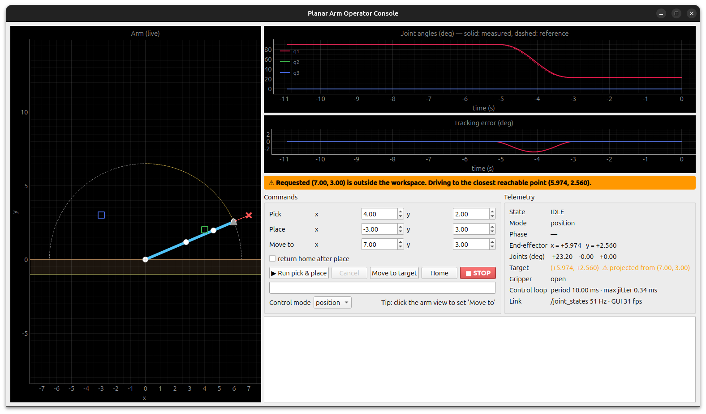

# 3-DoF Planar Arm: ROS 2 Control + Telemetry GUI

A small but complete ROS 2 (Jazzy) system for a simulated 3-DoF planar arm:
a controller node that plans smooth joint-space trajectories and closes the
loop in **position, velocity or effort (current) mode**, a **pick-and-place
action** with feedback and cancel, and a **PyQt5 / PyQtGraph operator GUI**
that runs the Qt event loop and the ROS 2 executor side by side.

- Design note (architecture, trade-offs, next steps): [docs/DESIGN.md](docs/DESIGN.md)
- Part 2, simulation → hardware: [docs/SIM_TO_REAL.md](docs/SIM_TO_REAL.md)



---

## Build

Tested on Ubuntu 24.04 + ROS 2 Jazzy, Python 3.12.

```bash
sudo apt install python3-pyqt5 python3-pyqtgraph   # GUI deps
cd ros2-planar-arm-control                          # workspace root
source /opt/ros/jazzy/setup.bash
colcon build --symlink-install
source install/setup.bash
```

> The workspace path must not contain quotes or apostrophes: CMake's Python
> helpers in `ament_cmake` break on them (I hit this with a folder name
> ending in an apostrophe).

## Run

```bash
ros2 launch planar_arm_control bringup.launch.py                       # position mode
ros2 launch planar_arm_control bringup.launch.py control_mode:=effort  # PID current control
ros2 launch planar_arm_control bringup.launch.py gui:=false            # headless
```

Launch arguments: `control_mode` (position|velocity|effort), `backend` (sim),
`control_rate_hz` (100), `publish_rate_hz` (50), `max_joint_velocity` (1.0 rad/s),
`max_joint_acceleration` (2.0 rad/s²), `sim_noise_std` (0 rad), `gui` (true).

### Fixed test scenario

In the GUI the fields come pre-filled: **Run pick & place** runs pick (4, 2) →
place (−3, 3). **Move to target** with (7, 3) runs the edge case. From a terminal:

```bash
ros2 action send_goal --feedback /pick_place planar_arm_interfaces/action/PickPlace \
  "{pick: {x: 4.0, y: 2.0}, place: {x: -3.0, y: 3.0}}"

ros2 service call /move_to_target planar_arm_interfaces/srv/MoveToTarget "{x: 7.0, y: 3.0}"
```

**Unreachable target (7, 3).** The point is 7.6 from the base but the arm reaches 6.5.
- A plain **move** goes to the closest reachable point (5.974, 2.560), replies
  `reachable: false`, and sets `target_projected` in `/arm_status`. The GUI shows
  an orange banner, a red ✕ at the requested point, and a dotted line to where
  the arm actually went.
- A **pick-and-place** with an unreachable pick or place is **aborted before
  moving**. Grasping at a projected point would grab empty air, so this is an
  error, not a warning.

Other controls: `/home` and `/stop` (`std_srvs/Trigger`), and switching mode at runtime while idle:
`ros2 param set /controller_node control_mode velocity` (or use the GUI drop-down).

## Interfaces

| Name | Type | Purpose |
|---|---|---|
| `/joint_states` | `sensor_msgs/JointState` | position, velocity, effort @ `publish_rate_hz` |
| `/arm_status` | `planar_arm_interfaces/ArmStatus` | state, mode, phase, reference, tracking error, EE, requested vs. active target, payload, loop jitter |
| `/move_to_target` | `planar_arm_interfaces/MoveToTarget` (srv) | plan + start a move; returns reachability, planned point, IK solution, duration |
| `/pick_place` | `planar_arm_interfaces/PickPlace` (action) | move → pick → move → place (→ home), with phase/progress feedback and cancel |
| `/home`, `/stop` | `std_srvs/Trigger` | go to home pose / freeze in place and abort the running goal |

## What's in the repo

```
src/
├── planar_arm_interfaces/          ament_cmake: ArmStatus.msg, MoveToTarget.srv, PickPlace.action
└── planar_arm_control/             ament_python
    ├── planar_arm_control/
    │   ├── planar_arm.py           PROVIDED kinematics (unmodified)
    │   ├── trajectory.py           quintic joint trajectories, via-point chains
    │   ├── motion_planner.py       workspace projection, IK validation, ground-safe paths
    │   ├── pid.py                  vectorised PID (anti-windup, D on velocity error)
    │   ├── tracking.py             reference -> position / velocity / effort command
    │   ├── hardware_interface.py   ArmBackend ABC, SimulatedArm, DynamixelBackend skeleton
    │   ├── controller_node.py      ROS 2 node: control loop, services, action, telemetry
    │   └── gui_node.py             PyQt5/PyQtGraph operator console
    ├── launch/bringup.launch.py
    └── test/                       pytest unit tests + launch_testing integration test
```

Everything below `controller_node.py` / `gui_node.py` is ROS-free and tested on its own.

## Tests

```bash
colcon test --packages-select planar_arm_control && colcon test-result --verbose
```

There are 25 unit tests and 1 launch test. The launch test starts the real
controller in effort mode and runs the fixed scenario, the unreachable pick and
the projected move over ROS.
